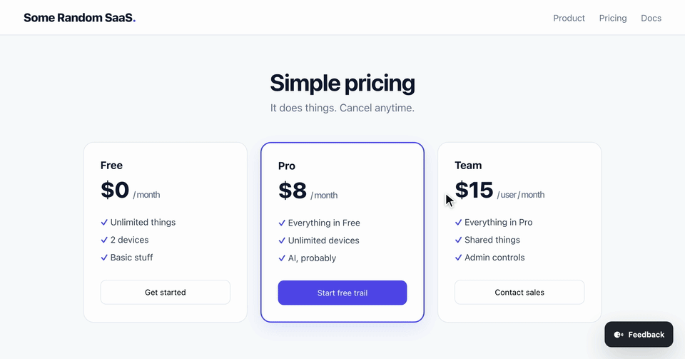

<p align="center"></p>

<h1 align="center">Tell Cecil</h1>

<p align="center"><a href="https://www.npmjs.com/package/tell-cecil"></a></p>

Feedback widget for any website. Visitors pick an element, write a comment, and it lands as a GitHub issue with the selector and page context. No dependencies, about 8 KB gzipped, MIT.

> **Alpha.** GitHub only; no screenshots or area selection yet.



## How it works

Visitors click **Feedback**, pick an **Element** (mouse, or Tab and Enter) or the whole **Page**, write a comment and send. The widget posts the report to a small relay you run, which files the issue with your GitHub token. Reporters need no GitHub account, and the token never reaches the page.

> **Public repo means public reports.** Use a private repo unless anyone may read the comments and page paths.

## Quick start

**1. Run the relay** (Node 20+) with a [fine-grained token](https://github.com/settings/personal-access-tokens/new) for one repo, Issues: read and write.

```sh
export CECIL_GITHUB_TOKEN=github_pat_...
export CECIL_GITHUB_REPO=owner/repo
export CECIL_PROJECT_KEY=pk_abc             # public, not a secret
export CECIL_ORIGINS=https://yoursite.com   # exact origins, comma-separated
npx tell-cecil                              # http://localhost:8787
```

Optional: `CECIL_LABELS`, `PORT`, and `CECIL_TRUST_PROXY=1` behind your own reverse proxy. The variables can also live in a `.env` file in the current folder.

**2. Add the widget.**

```html
<script src="https://cdn.jsdelivr.net/npm/tell-cecil@0.0.1/dist/cecil.js"
  data-endpoint="https://relay.example.com"
  data-project-key="pk_abc"></script>
```

Or `npm i tell-cecil`, then `import { init } from "tell-cecil"` and `init({ endpoint, projectKey })`.

**Reports fail?** The browser console says why. A 403 means a wrong project key or an origin missing from `CECIL_ORIGINS`, which must match the address bar exactly: `http://127.0.0.1:5173` is not `http://localhost:5173`.

**Other hosts.** `createRelay` from `tell-cecil/relay` is a `(Request) => Response` function, so it runs in your own server, Cloudflare Workers, Vercel, Deno or Bun. See the [Worker example](examples/cloudflare-worker) and the [Dockerfile](Dockerfile).

## Security

The origin check stops other websites, not scripts, so the relay also rate limits: 10 reports a minute per IP and 60 per project, in memory. On a public site, add your host's rate limiting too. The endpoint must be https unless it is localhost. Under a strict CSP, allow the relay in `connect-src` and the script's host in `script-src`; styles need no `style-src` exception.

## Privacy

Tell Cecil never reads input values, editable content or page HTML. It sends the element's selector, role, accessible name, a short text excerpt, a few attributes, ancestors and position, and the page URL without its query string and hash.

- `data-cecil-private`: the element and its children can't be picked.
- `data-cecil-mask`: it can be picked, but its text and name are left out. Form fields and `contenteditable` are masked by default.
- Your own selectors: `data-exclude=".admin"` and `data-mask=".iban"`, or `privacy: { exclude, mask }` in `init`.

## Reference

**Widget:** `init(options)`, or data attributes on the script tag. `init` returns a function that removes the widget.

| Option | Attribute | |
| --- | --- | --- |
| `endpoint` | `data-endpoint` | Relay URL, may be relative. Required. |
| `projectKey` | `data-project-key` | Public key the relay maps to a repo. Required. |
| `user` | `data-user` | Reporter name on the issue (string or function). Unverified. |
| `privacy.exclude` | `data-exclude` | Selectors that can't be picked. |
| `privacy.mask` | `data-mask` | Selectors whose text is left out. |
| `privacy.url` | `data-full-url` | Rewrite the page URL; the attribute sends it in full. |

**Relay:** `createRelay(options)`.

| Option | Default | |
| --- | --- | --- |
| `projects` | required | Key to `{ origins, github: { repo, token, labels? }, exposeIssueUrl? }`. `exposeIssueUrl: false` hides the issue link from reporters. |
| `rateLimit` | `{ max: 10, projectMax: 60, windowMs: 60000 }` | Per IP and per project. |
| `clientIp` | `cf-connecting-ip`, else last `x-forwarded-for` | Client identity for rate limiting. |
| `fetch`, `now` | globals | For tests. |

## Develop

```sh
npm install && npm test
npm run dev     # demo page on http://localhost:5173
npm run relay   # relay from source, beside it
```

## License

MIT
